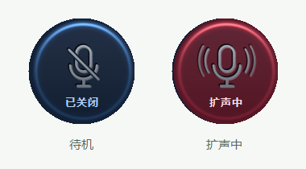

# MicCast · 投屏麦克风

一个可拖动的悬浮麦克风小球，将笔记本内置麦克风送到普通双声道 VB-CABLE，供 ESHOW 分享到大屏。点击开始，再点停止；停止或退出时自动恢复原来的 Windows 默认输出。

**[下载最新版 MicCast.exe](https://github.com/SUGE2016/MicCast/releases/latest/download/MicCast.exe)** · [全部版本](https://github.com/SUGE2016/MicCast/releases) · [CI](https://github.com/SUGE2016/MicCast/actions)



## 使用

1. 连接 ESHOW，开启投屏声音分享。
2. 双击下载的 `MicCast.exe`，桌面右下方出现麦克风小球。
3. 左键点击小球开始扩声；红色外圈、声波图标和“扩声中”表示麦克风链路已启动。再次点击停止，回到蓝色外圈、斜线麦克风和“已关闭”。

拖动小球可调整位置；右键菜单可停止、查看说明或退出。鼠标悬停可查看状态和错误详情。小球保持正圆、置顶显示，无标题栏、无任务栏按钮。外圈采用首尾连续的柔光渐变：待机转蓝光，扩声转红光，扩声时转速更快。连接时显示“连接中”，故障时显示琥珀色和“需处理”。

中心为银灰色金属蚀刻麦克风图标；扩声时两侧显示向外展开的双层声波弧线。

应用自动选择内置麦克风阵列和普通 VB-CABLE 播放端，无需手动修改 Windows 默认输出。本机播放端名称为 **扬声器 (VB-Audio Virtual Cable)**；英文名称可能为 **CABLE Input**。16 Ch 设备及 CABLE Output 录音端会被排除。若存在多个匹配设备，会提示处理重复设备。

首次使用需单独安装 [VB-CABLE 官方驱动](https://vb-audio.com/Cable/)，并允许桌面应用使用麦克风。缺少驱动时，小球显示琥珀色“需安装”，自动显示安装引导，提供“打开官方下载页”按钮；右键菜单也保留安装入口。安装后重启 Windows，再打开 MicCast。项目不包含驱动安装包。运行环境为 Windows x64、.NET Framework 4.7.2 或兼容的 4.x 运行时；当前已验证本机的音频链路。

如果大屏没有声音，在扩声开启后重新开关 ESHOW 的声音分享，使其重新捕获当前输出。ESHOW 是否跟随默认输出、声音延迟及实际扩声效果需在教室确认。大屏先保持较低音量，逐步调高，留意啸叫。

麦克风只连接 VB-CABLE 播放端。跟随默认输出的媒体声音也会转入该设备；通信角色保留原设置。显式绑定电脑扬声器的其他应用仍可能从电脑出声。

## 构建

固定工具链：.NET SDK **10.0.115**、.NET Framework **4.7.2 Developer Pack**、Windows SDK **10.0.19041.0**（包含 Desktop C# 元数据）。`global.json` 固定编译器版本。可从 [Microsoft .NET 下载页](https://dotnet.microsoft.com/download/dotnet)、[Framework 4.7.2 下载页](https://dotnet.microsoft.com/download/dotnet-framework/net472)及 [Windows SDK 归档](https://developer.microsoft.com/windows/downloads/sdk-archive/)取得构建工具。

在项目目录执行：

```powershell
powershell -NoProfile -ExecutionPolicy Bypass -File .\build.ps1
```

输出为单个 `bin\Release\MicCast.exe`，无需附带配置文件。构建使用本地 Windows SDK 和 Framework 引用，不需要 NuGet 依赖恢复。确定性编译已启用；相同源码和固定工具链的 EXE 可进行 SHA-256 比对。

## 自测

不访问麦克风、不切换系统输出的逻辑测试和单 EXE 界面检查：

```powershell
powershell -NoProfile -ExecutionPolicy Bypass -File .\test.ps1
```

关闭所有 MicCast 实例后，执行硬件自测：

```powershell
powershell -NoProfile -ExecutionPolicy Bypass -File .\test.ps1 -Hardware
```

硬件自测短暂接通麦克风，两次切换默认输出并恢复，结果保存至 `TestResults`。它会检查音频图处理帧数、两个默认播放角色、通信角色和停止后的三个角色。帧数证明音频图运行；大屏听感和传输延迟需要现场测试。自测不保存音频。

也可通过 `MicCast.exe --self-test` 调用相同检查，退出码 0 表示通过、1 表示失败、2 表示实例冲突或参数错误。WinForms 程序的终端输出需要重定向，推荐直接使用上面的脚本。

## 输出恢复

切换前，三个输出角色保存在 `%LOCALAPPDATA%\MicCast\restore.txt`。恢复时逐一设置并核对，全部成功后才删除记录。停止会恢复启动前的快照，包括运行期间手动改变过的默认输出。

异常终止后，下次打开 MicCast 会先恢复；也可在关闭其他实例后运行 `MicCast.exe --restore`。如果原设备已断开，重新连接后重试。恢复失败时保留记录并提示原因，正常退出会等待恢复成功。

## 源码

`src/MicCast.cs` 包含 AudioGraph 路由、单实例入口和硬件自测；`src/MicForm.cs` 实现悬浮小球；`src/DriverSetup.cs` 检查驱动和提供安装引导；`src/Defaults.cs` 管理三个音频角色与恢复记录；`src/DeviceSelection.cs` 定义设备筛选。`tests` 包含设备与存储故障模拟测试，以及单 EXE 启动和界面绘制检查。

音频使用 Windows AudioGraph，默认输出切换调用 Windows 内部 PolicyConfig COM 接口。Windows 版本升级后需验证该接口的行为。设备名称识别目前支持中文和英文麦克风阵列名称。

## CI 与 Release

GitHub Actions 在 Windows Server 2022 上构建，固定使用 `global.json` 中的 SDK，运行逻辑测试及单 EXE 检查，不调用真实音频设备。主分支推送和 PR 触发 CI，产物保留 14 天。

发布时同步 `VERSION`、`src/AssemblyInfo.cs`、`src/app.manifest` 的版本，并添加 `docs/releases/vX.Y.Z.md`。推送对应的 `vX.Y.Z` 标签后，CI 通过才会创建 GitHub Release，附带 `MicCast.exe`、SHA-256 校验文件、快速开始和许可证。普通分支推送不会发布 Release。

## 许可证

作者：**新BUG主理人**。MicCast 使用 [MIT License](LICENSE)，许可证正文也嵌入 EXE。VB-CABLE、ESHOW 和 Microsoft 运行环境分别由各自提供方分发；源码项目不捆绑第三方驱动或投屏软件。
